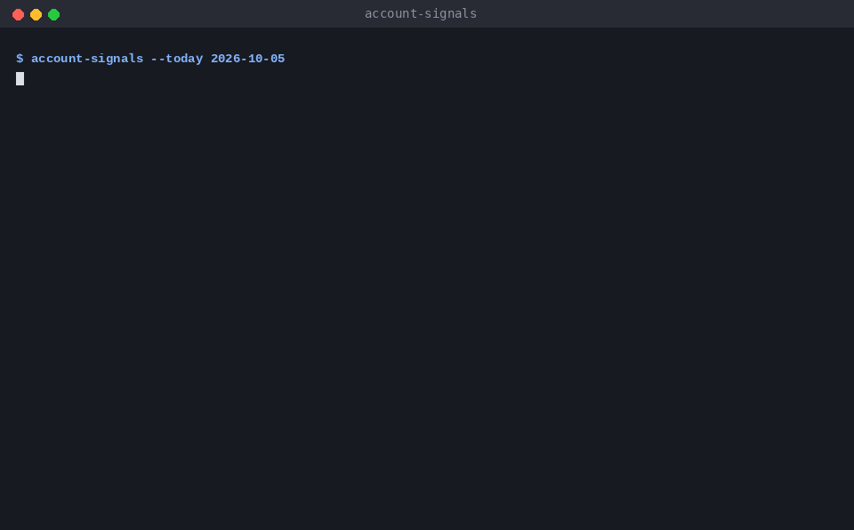
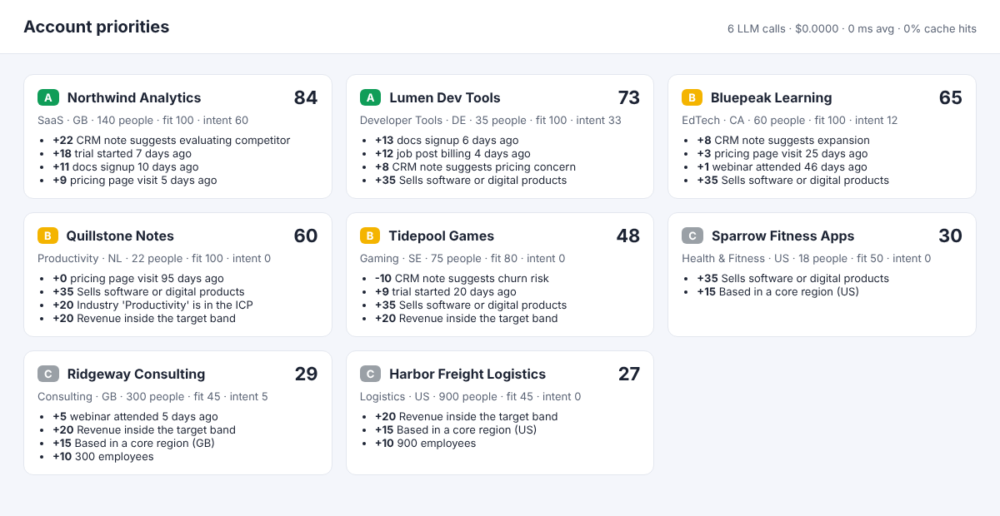

# account-signals

Sales teams have more accounts than time. This service ranks them by how well they fit the ideal customer profile and how strongly they're showing buying intent right now. Every score comes with the reasons behind it, so a rep knows why an account is at the top, not only that it is.





## What it does

1. **ICP fit.** Each account gets points for selling software, industry, region, revenue band and size. Each point comes with a human-readable reason.
2. **Buying signals.** Product and marketing events such as pricing page visits, docs sign-ups, trials and billing-related job posts are weighted and decay with a 14-day half-life, so last week counts more than last quarter.
3. **CRM notes.** Unstructured notes from account executives are classified into intents: evaluating a competitor, pricing concern, expansion, churn risk or none. Positive intents raise priority; churn risk lowers it.
4. **Priority and tiers.** Fit and intent combine into a 0–100 priority and A/B/C tiers. They're served over an API, a CLI and an HTML report.

## Running LLMs in production, not just in a demo

- **Guarded outputs.** The model must return JSON with a label and a short quote copied verbatim from the note. Malformed JSON, unknown labels or evidence that doesn't appear in the note are rejected and counted, and the note falls back to `none`. A hallucinated reason can't push an account up the list.
- **Routing.** Short notes go to a small, cheap model and long ones to a larger model. The rule is one function, easy to replace with something smarter.
- **Caching.** Completions are cached in SQLite by model and prompt hash. Re-scoring the same notes costs nothing, and cache hits are reported.
- **Cost and latency tracking.** Every call records model, tokens, latency and cost in `llm_calls`. `/usage` and the report header summarise them.
- **Evals as a gate.** `evals/run_evals.py` runs a labelled set of notes through the classifier. It prints per-intent precision and recall, misses, rejected outputs, latency, cost and cache hits, and fails CI below a threshold. The keyword baseline scores 88%. The two misses are a useful reminder of why the LLM path exists: "plans to cancel the current provider" is a switching opportunity, not churn.
- **Runs offline.** Without `OPENAI_API_KEY` the classifier uses a deterministic keyword baseline, so tests, evals and the demo run anywhere.

## Tech stack

Python 3.12, SQL (SQLite), FastAPI, Pydantic, httpx, OpenAI Chat Completions (JSON mode), pytest, ruff, mypy (strict), Docker, GitHub Actions

## Running it

```bash
python -m venv .venv && . .venv/bin/activate
pip install -e ".[dev]"

account-signals --today 2026-10-05                   # load data/ and print the ranking
python evals/run_evals.py 0.85                       # offline evals, exit code 1 below the threshold
SIGNALS_SEED_DIR=data uvicorn account_signals.server:app --port 8000
curl -X POST localhost:8000/refresh
open http://localhost:8000/report
```

Set `OPENAI_API_KEY` to use real models. `SIGNALS_SMALL_MODEL` and `SIGNALS_LARGE_MODEL` choose them; they default to `gpt-4o-mini` and `gpt-4o`. Per-token prices for cost tracking are set in `wiring.py`.

| Endpoint | |
| --- | --- |
| `POST /refresh` | Classify new notes and re-score every account |
| `GET /accounts?tier=A` | Ranked accounts with fit, intent, priority and reasons |
| `GET /accounts/{id}` | One account's score and explanation |
| `GET /usage` | LLM calls, cost, latency and cache hit rate |
| `GET /report` | HTML report |

## Data

`data/` holds a small fictional dataset: accounts, events and CRM notes as CSV. Replace it with exports from your CRM and product analytics; the loader expects the same columns.

## Tests

```bash
ruff check . && mypy && pytest
```

## License

MIT
